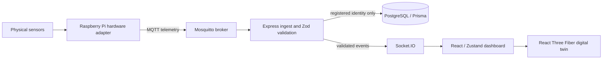

# Architecture

**Demo mode**: React uses locally labeled example data. The backend also has independently labeled example GET endpoints. In demo mode, the Raspberry Pi publisher can generate clearly labeled test signals, but the API does not write them to a live sensor database.

**Live mode**: PostgreSQL is required, seed the legitimate machine/component/sensor registry, and stream MQTT messages through a broker. The topic, payload and registered sensor record must all agree. The incoming payload has the measurement timestamp; the database records the server receive timestamp separately.

**Visualization**: The CNC model is procedural and individually selectable with stable component IDs. To add a licensed GLTF/GLB asset, load it with `useGLTF`, map named meshes to Component IDs, and document licensing/attribution in `docs/ASSETS.md`. Do not assume existing primitive meshes reflect physical CAD dimensions.

**Security considerations**: Use TLS on browser, API, MQTT. Firewall or private-network the broker; set MQTT username/password; do not expose Docker development credentials. Protect maintenance writes with per-user RBAC, add device-level MQTT ACLs by topic, implement retention policies, rate limits, audit logs and backups. Current auth uses a single configured admin account and is not production identity management.

**Scoring**: `computeRisk` reports transparent threshold crossings and unknown when no configured metric is present. It never claims trained AI, validated failure probabilities or exact predicted dates. Configure thresholds per sensor after calibration and engineering review.
